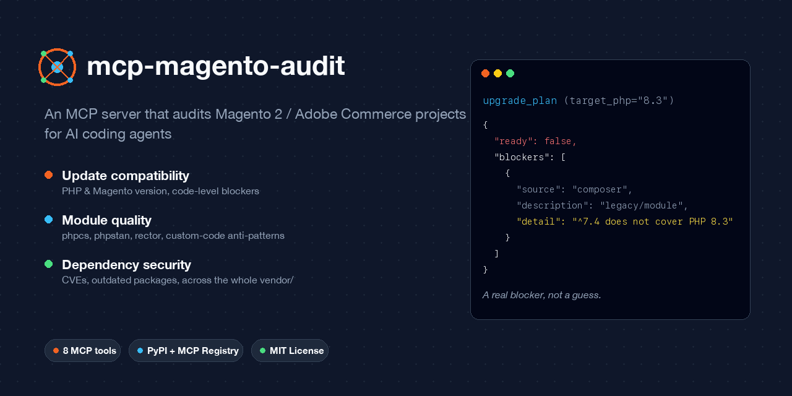
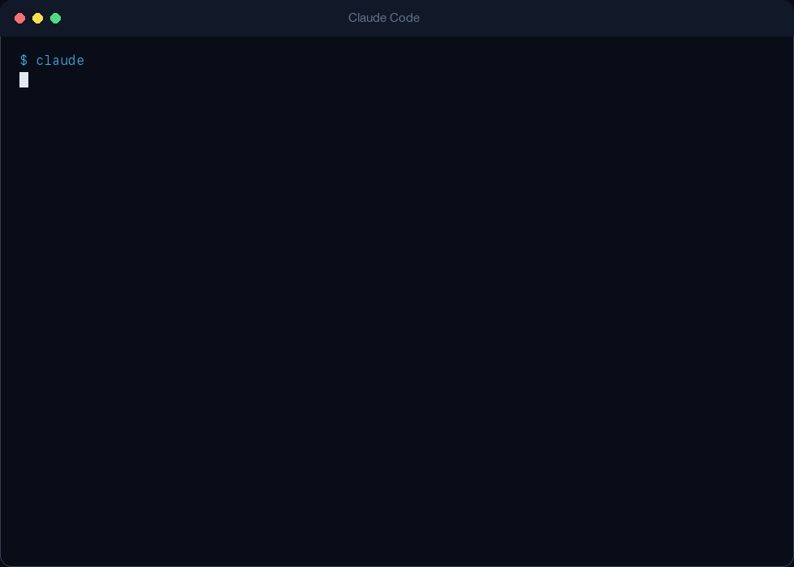

# mcp-magento-audit

<!-- mcp-name: io.github.michalper/mcp-magento-audit -->



[](https://github.com/michalper/mcp-magento-audit/actions/workflows/ci.yml)
[](https://pypi.org/project/mcp-magento-audit/)
[](https://glama.ai/mcp/servers/michalper/mcp-magento-audit)
[](LICENSE)
[](pyproject.toml)
[](https://github.com/astral-sh/ruff)
[](https://github.com/michalper/mcp-magento-audit/commits/master)

An [MCP](https://modelcontextprotocol.io) server giving an AI agent tools to assess a
Magento 2 / Adobe Commerce project along three axes: **compatibility with a target PHP
and Magento version**, **quality of custom modules**, and **dependency security**.

It answers the question that never stops coming up in Magento agencies:
*"can we bump this client to a newer version, what's blocking it, and where do we start?"*

> **Status: early stage.** Built on evenings/weekends. All eight planned tools
> (`get_project_status`, `check_updates`, `scan_module_risk`, `audit_security`, `check_outdated_packages`,
> `fetch_release_notes`, `build_upgrade_plan`, `build_fleet_overview`) are working. See `ROADMAP.md` for
> what's next.

## How this differs from `composer audit`

`composer audit` and `composer outdated` are built into Composer and do their job well —
`audit_security` and `check_outdated_packages` actually shell out to them rather than
reimplementing a CVE database or version comparison. This server targets what plain
Composer doesn't give you:

1. **It doesn't see `app/code`.** Custom modules don't exist on Packagist, so they get
   zero coverage from vulnerability databases — and that's exactly the code agencies write.
   `scan_module_risk` covers that side with `phpcs`/`phpstan`/`rector` instead.
2. **It doesn't combine axes.** Nobody gets one answer: *this module blocks the upgrade,
   has an open CVE, is abandoned by its author, and has the worst complexity in the
   project — fix this one first.* `build_upgrade_plan` does, folding `audit_security`'s
   advisories in alongside composer-constraint and code-quality blockers.
3. **It doesn't aggregate across projects.** "Which of our twenty stores can be upgraded
   today" requires stitching results together from many directories by hand. `build_fleet_overview`
   runs the composer-constraint check across every project path given to it in one call —
   a fast first pass, not a replacement for a full `build_upgrade_plan` per project.

**What this server doesn't pretend to be:** there's no clean dataset of "module X works
with Magento 2.4.8". Results are derived from declarations in `composer.json`, a code
scan, and the vendor's own release notes — this is a decision-support tool, not an
oracle. Upgrading a production store still requires testing, not just a report.

## Install

```bash
git clone https://github.com/michalper/mcp-magento-audit.git
cd mcp-magento-audit
python3.12 -m venv .venv
.venv/bin/pip install -e ".[dev]"
```

## Connecting to Claude Code

```json
{
  "mcpServers": {
    "magento-audit": {
      "command": "/path/to/mcp-magento-audit/.venv/bin/mcp-magento-audit"
    }
  }
}
```

### Projects that develop inside Docker/DDEV/Warden/Lando

`scan_module_risk` (phpcs/phpstan/rector), `check_updates`'s `code_compatibility` signal, and
`audit_security`/`check_outdated_packages` all shell out to the project's own `vendor/bin/*`
and `composer`. If that project only has PHP/Composer available *inside* a dev container
— common for Magento — and this MCP server runs on the host, every one of those checks
will correctly report `scanned=false` with a reason rather than silently being wrong, but
that's easy to misread as "found nothing" instead of "couldn't check".

Set `MCP_MAGENTO_AUDIT_EXEC_PREFIX` to wrap every one of those calls in a command that
runs it inside the container instead, e.g.:

```bash
export MCP_MAGENTO_AUDIT_EXEC_PREFIX="ddev exec --"
# or: export MCP_MAGENTO_AUDIT_EXEC_PREFIX="docker compose exec -T app"
```

This assumes the usual bind-mount setup (the project directory mirrors the same
relative layout inside the container, just under a different root) — host-absolute
paths like `vendor/bin/phpcs` are rewritten relative to the project root before being
wrapped, and `composer` resolves against the container's own `PATH` rather than the
host's. If that assumption doesn't hold for a given setup, running this server from
inside the dev container directly (no prefix needed) is the more reliable fallback.

### Rate limits on GitHub API calls

`fetch_release_notes` calls the GitHub REST API, capped at 60 requests/hour per IP when
unauthenticated — easily hit from a shared office/CI IP running `build_fleet_overview` or
`build_upgrade_plan` across many projects. Set `GITHUB_TOKEN` (or `GH_TOKEN`) in the
environment to raise that to 5000/hour; a read-only, no-scope token is enough, since this
only ever reads public release data.

## Example



An agent calling `build_upgrade_plan` against a store that has one abandoned, PHP-7-only
package and no `phpstan.neon` of its own (trimmed — the real result also includes
`release_notes`, and the full `update_check`/`scan_module_risk` results each blocker was
derived from):

```json
{
  "ready": false,
  "unverified": [
    "phpstan: no phpstan.neon(.dist) in project — skipping static analysis"
  ],
  "blockers": [
    {
      "source": "composer",
      "description": "legacy/module",
      "detail": "^7.4 does not cover PHP 8.3"
    }
  ]
}
```

`ready` is false because of a real blocker, not a guess; `unverified` says phpstan never
ran at all, so a clean result elsewhere isn't mistaken for "everything was checked".

## Tools

| Tool | Status | Description |
|---|---|---|
| `get_project_status` | **working** | Magento version, PHP requirement, package count, abandoned packages |
| `check_updates` | **working** | per-package verdict against a target PHP/Magento version, plus a Rector-based check of whether the code itself would need changes |
| `scan_module_risk` | **working** | scans code via `phpcs` (Magento2 coding standard), the project's own `phpstan`, and the project's own `rector.php` (dead code/quality) — plus a separate `phpcs` pass over third-party `vendor/` Magento modules (informational, not an upgrade blocker), a plain regex scan for `ObjectManager::getInstance()` misuse in `app/code` (not limited to `.phtml`, unlike the standard's own sniff), a core-override check (`app/code` classes that redeclare a `vendor/magento/*` class under the same FQCN — an upgrade blocker), and a dangling-reference check (`di.xml`/`events.xml`/`crontab.xml`/layout XML/`indexer.xml`/`schema.graphqls` naming a PHP class that no longer exists — informational) |
| `audit_security` | **working** | every installed package in `composer.lock` — core Magento, third-party `vendor/` extensions, dev dependencies — checked for known advisories via `composer audit` |
| `check_outdated_packages` | **working** | every installed package checked against `composer outdated` for a newer available version — independent of known CVEs or target-version compatibility |
| `fetch_release_notes` | **working** | release notes from `magento/magento2` GitHub Releases, **without answering from the model's memory** |
| `build_upgrade_plan` | **working** | combines the other tools into a list of concrete blockers, with `ready=true` only once it's empty |
| `build_fleet_overview` | **working** | triages many projects at once against a target PHP/Magento version ("which of these N stores can be upgraded today") via `check_updates` only — a fast first pass, not a replacement for `build_upgrade_plan` per project |

## Development

```bash
.venv/bin/python -m pytest --cov        # tests + coverage
.venv/bin/ruff check .                  # lint
.venv/bin/mypy src                      # types
.venv/bin/bandit -c pyproject.toml -r src   # security
.venv/bin/pip-audit                     # dependency vulnerabilities
```

Run `.venv/bin/pre-commit install` once to run all of the above (except
`pip-audit`, which needs network access and stays CI-only) on every commit.

Architectural decisions are recorded in `docs/adr/`. See `CHANGELOG.md` for what
changed in each release.

## License

MIT
